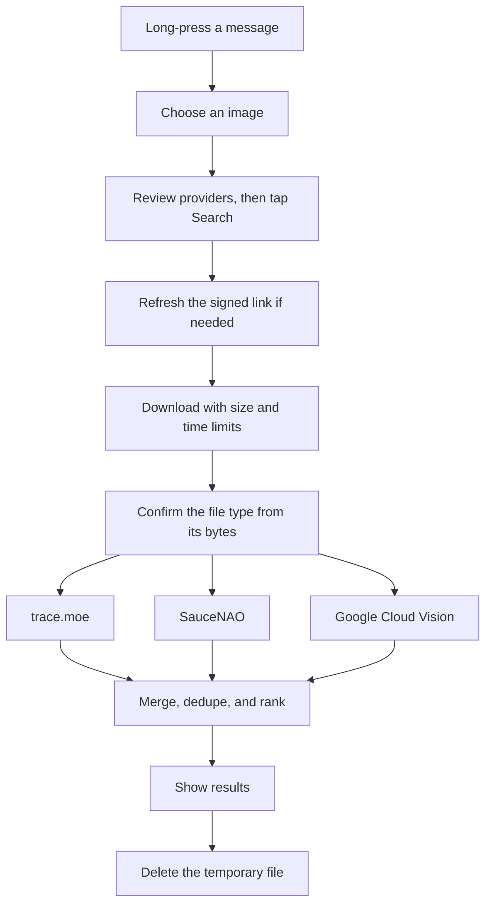

<div align="center">

# Reverse Image Search for Valenced

**Find where a Discord image came from, without leaving Discord.**

[](https://github.com/quiet-falcon/lo-reverse-img-search-plugin/actions/workflows/validate.yml)
[](#project-status)
[](LICENSE)
[](https://github.com/Valenced/valenced)

[Status](#project-status) · [Planned features](#planned-features) · [How it works](#how-it-will-work) · [Privacy](#privacy) · [Development](#development)

</div>

> [!IMPORTANT]
> This plugin is in early development. The current build adds a **Search Image** row, a viewer button, and browser hand-offs to 8 engines. In-app anime results from trace.moe work on a real device. There is no public release so far.

## Why it exists

Reverse image search on Discord mobile has a long-standing problem: search engines are handed a Discord link, then fail on its signed URL or its `application/octet-stream` content type.

This plugin takes a different route. It downloads the image with strict limits, checks what it really is, and uploads the bytes directly to the engines you choose. Results then appear in one native sheet inside Discord.

## Project status

| Phase | Goal | Status |
| --- | --- | --- |
| **P0** | Foundation, build pipeline, and device probe | ✅ Passed |
| **P1** | Long-press entry and browser hand-offs | ✅ Passed |
| **P2** | Secure image pipeline and trace.moe results | ✅ Passed |
| **P3** | SauceNAO results and ranked merging | ✅ Passed |
| **P4** | Google Cloud Vision and the copy check | ⬜ Not started |
| **P5** | Polish, full device testing, and `1.0.0` | ⬜ Not started |

Each phase must pass before the next begins. Tested versions and evidence are recorded in [`docs/compatibility.md`](docs/compatibility.md).

## Planned features

Everything in this section is planned, not yet built.

### 🔎 Search from where you already are

- Long-press a message and tap **Search Image**.
- Pick one image when a message has several.
- Add a button to the full-screen viewer, if device testing confirms the hook.

### 🧠 One ranked results sheet

| Image type | Provider | Result | Setup |
| --- | --- | --- | --- |
| Anime frame | [trace.moe](https://soruly.github.io/trace.moe-api/) | Title, episode, and timestamp | None |
| Art or manga | [SauceNAO](https://saucenao.com/) | Artist and source page | Free API key |
| Photo, meme, or screenshot | [Google Cloud Vision](https://cloud.google.com/vision) | Pages using the image | Your own API key |

Provider scores aren't comparable, so results are ranked into **Exact**, **Strong**, and **Possible** tiers instead of being averaged. Each provider's status is always shown.

### 🌐 One-tap browser hand-offs

Google Lens, Yandex, Bing, TinEye, SauceNAO, IQDB, trace.moe, and ImgOps. Each row opens one engine, and engines that fail in testing get hidden.

### 🧾 Copy check

Has this image been used across the web? The copy check helps you spot a profile photo that may be copied, or warn someone that their own photo is being reused.

| Distinct sites | Label |
| --- | --- |
| 0 | No copies found |
| 1 to 4 | Found on a few sites |
| 5 to 19 | Found on several sites |
| 20 or more | Widely used online |

The check needs a Google Cloud Vision key. Without one, the TinEye hand-off shows a total match count and can sort by oldest. Vision returns lists rather than a total, so counts read "at least".

The plugin never calls a photo stolen, fake, or safe, because it can't know that. Copies don't prove who owns a photo, and no copies doesn't prove it's real.

## How it will work



The design is JavaScript only, with no server, no scraping for in-app results, and no native Kotlin build.

## Privacy

These rules are built into the project:

- **You start every search.** Nothing is sent automatically or in the background.
- **You see who gets the image.** The button names each provider before anything leaves your device.
- **Your Discord token stays out of it.** The plugin never reads, requests, or sends it.
- **Your keys stay in settings.** They're never hard-coded, logged, or committed.
- **There's no telemetry.** No analytics or hidden network calls.
- **There's no bulk scanning.** No channel sweeps, background indexing, or self-bot behaviour.
- **There's no face recognition.** The plugin matches pictures, not people, and won't use engines such as PimEyes.

| Search path | What leaves your device |
| --- | --- |
| In-app provider | Image bytes and your IP address, sent to that provider |
| Browser hand-off | The image link, including channel ID, attachment ID, filename, and a temporary signature |
| Link refresh | The attachment link, sent to Discord as normal client traffic |
| Result thumbnails | Your IP address, sent to the host serving each thumbnail |

A photo already online can lead to a page that names the person in it. That's how reverse image search works, so this plugin doesn't promise otherwise. See [`docs/privacy.md`](docs/privacy.md).

## Installation

There is no public release yet, so this section is for testers.

1. Open the latest passing [Validate run](https://github.com/quiet-falcon/lo-reverse-img-search-plugin/actions/workflows/validate.yml).
2. Download the plugin ZIP from **Artifacts**. You need to be signed in to GitHub.
3. In Discord, go to **Settings > Valenced > Plugins**, tap the settings gear, then **Install from file**.
4. Pick the ZIP and confirm its name and version.
5. Enable the plugin from its card.

The filename ending in `-probe` is a development build. It adds a settings page that reports version numbers, screen names, and field names, never field values. Its report stays in memory until you copy it.

## Development

### Requirements

| Tool | Version | Needed for |
| --- | --- | --- |
| [Bun](https://bun.sh) | 1.4.4 | Dependencies, tests, and bundling |
| JDK | 25 | Packaging the ZIP |
| ADB | Any | Optional local install testing |

Plugin builds don't need the Android SDK or a GitHub Packages token. GitHub Actions can do all of the building, so a phone is enough for day-to-day work.

### Commands

```sh
bun install --frozen-lockfile
bun run verify
./gradlew --no-daemon packageReverseImageSearch
./gradlew --no-daemon packageReverseImageSearch -Pdev
```

`bun run verify` runs lint, type-checking, tests, and the bundle build. The ZIP lands in `build/dist/`, and `-Pdev` packages the device probe.

### Repository layout

```text
plugins/reverse-image-search/
├── manifest.json       Plugin identity and dependencies
└── js/
    ├── index.ts        Lifecycle wiring
    ├── core/           Pure logic with no host imports
    ├── adapters/       Discord and Valenced access
    └── ui/             React components
tests/                  Unit and adapter tests
docs/                   Compatibility, privacy, and provider notes
CLAUDE.md               Full engineering specification
```

### Contributing

Read [`CLAUDE.md`](CLAUDE.md) first. It holds the architecture, rules, test plan, and phase gates. Work phase by phase, keep changes small, and use fake URLs in every test, issue, and screenshot.

## Known limitations

- Client modifications break Discord's Terms of Service, and you use them at your own risk.
- Discord can change its internal modules at any time.
- Providers can change their limits or stop service.
- No search method finds every image.

## Acknowledgements

Built on the [Valenced plugin template](https://github.com/Valenced/valenced-plugin-template). The design also learned from [Valenced community plugins](https://github.com/Valenced/valenced-community-plugins), and attribution is kept in [`NOTICE.md`](NOTICE.md).

## Licence

[GPL-3.0](LICENSE), inherited from the Valenced plugin template.
